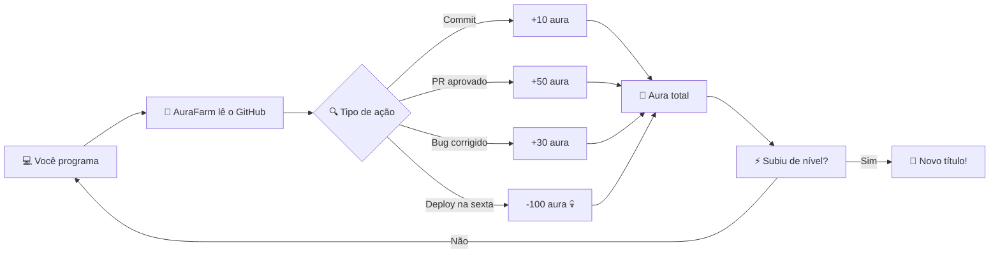

<div align="center">


<a href="https://git.io/typing-svg">
  
</a>

<br/>


<br/>

**[🚀 Começar](#-instalação-em-30-segundos) · [✨ Recursos](#-recursos) · [🧠 Como funciona](#-como-funciona) · [🗺️ Roadmap](#️-roadmap) · [🤝 Contribuir](#-contribuindo)**

</div>

---

## 🔮 O que é isso?

**AuraFarm** é uma ferramenta de linha de comando que transforma sua rotina de programação em um **RPG de verdade**. Cada commit, cada issue fechada e cada bug corrigido rende **pontos de aura**. Subiu de nível? Ganhou título. Quebrou a produção numa sexta-feira? Perdeu aura.

> *"Aura não se pede. Aura se farma."*
> — Provérbio ancestral dos devs

<div align="center">

```
╔══════════════════════════════════════════╗
║  🔮 AURA TOTAL ........... 12.847 pts    ║
║  ⚡ NÍVEL ................ 42 (Lendário)  ║
║  🔥 STREAK ............... 31 dias       ║
║  🏆 PRÓXIMO TÍTULO ....... Arquimago      ║
║  ▓▓▓▓▓▓▓▓▓▓▓▓▓▓▓▓░░░░ 78%                ║
╚══════════════════════════════════════════╝
```

</div>

---

## ✨ Recursos

| | Recurso | Descrição |
|:-:|---|---|
| ⚔️ | **Sistema de níveis** | Do *Estagiário Confuso* ao *Arquimago do Código* |
| 🔥 | **Streaks diários** | Mantenha a sequência e ganhe multiplicadores de aura |
| 🏆 | **Conquistas** | Mais de 50 badges desbloqueáveis (e algumas secretas 👀) |
| 📊 | **Dashboard no terminal** | Gráficos lindos direto no seu console |
| 🌐 | **Integração com GitHub** | Lê seus commits, PRs e issues automaticamente |
| 🎨 | **Temas** | Neon, Sakura, Matrix, Dracula e mais |
| 🧙 | **Ranking de amigos** | Compare sua aura com a galera |

---

## 🚀 Instalação em 30 segundos

```bash
# 1. Clone o repositório
git clone https://github.com/USUARIO/aurafarm.git
cd aurafarm

# 2. Instale as dependências
pip install -r requirements.txt

# 3. Comece a farmar
python -m aurafarm start
```

Ou, se preferir, direto pelo **pip**:

```bash
pip install aurafarm
aurafarm init
```

---

## 🎮 Uso rápido

```bash
aurafarm status          # 📊 Veja sua aura atual
aurafarm farm            # ⚡ Sincronize suas atividades
aurafarm ranking         # 🏆 Ranking global
aurafarm conquistas      # 🎖️ Suas badges
aurafarm tema sakura     # 🎨 Mude o visual
```

---

## 🧠 Como funciona



### 📜 Tabela de aura

| Ação | Aura |
|---|:-:|
| 🟢 Commit com mensagem decente | `+10` |
| 🟢 Pull Request aprovado | `+50` |
| 🟢 Issue fechada | `+25` |
| 🟢 Bug corrigido de primeira | `+30` |
| 🟢 Escrever testes | `+40` |
| 🟢 Documentação | `+20` |
| 🔴 Commit com mensagem "asdf" | `-15` |
| 🔴 Deploy na sexta-feira | `-100` |
| 🔴 `git push --force` na main | `-500` 💀 |

---

## 👑 Títulos e níveis

<details>
<summary><b>🔓 Clique para ver todos os títulos</b></summary>

<br/>

| Nível | Título |
|:-:|---|
| 1–10 | 🐣 Estagiário Confuso |
| 11–20 | 🛠️ Aprendiz do Terminal |
| 21–30 | ⚔️ Cavaleiro do Código |
| 31–40 | 🧙 Mago das Pull Requests |
| 41–50 | 🐉 Lenda Viva |
| 51+ | 🌌 Arquimago do Código |

</details>

---

## 🛠️ Tecnologias

<div align="center">


</div>

---

## 🗺️ Roadmap

- [x] Sistema básico de aura e níveis
- [x] Integração com a API do GitHub
- [x] Streaks e multiplicadores
- [x] Temas personalizados
- [ ] 🌐 Ranking online entre amigos
- [ ] 🤖 Narrador de aura com IA
- [ ] 📱 App mobile
- [ ] 🎵 Efeitos sonoros ao subir de nível

---

## 🤝 Contribuindo

Contribuições são **muito** bem-vindas!

1. Faça um **fork** do projeto
2. Crie sua branch: `git checkout -b feature/minha-ideia-genial`
3. Commit suas mudanças: `git commit -m 'feat: adiciona ideia genial'`
4. Push para a branch: `git push origin feature/minha-ideia-genial`
5. Abra um **Pull Request** e receba sua aura 🔮

---

## 📄 Licença

Distribuído sob a licença **MIT**. Veja o arquivo [`LICENSE`](LICENSE) para mais detalhes.

---

<div align="center">

### 💜 Gostou? Deixe uma ⭐ e farme aura!


</div>
